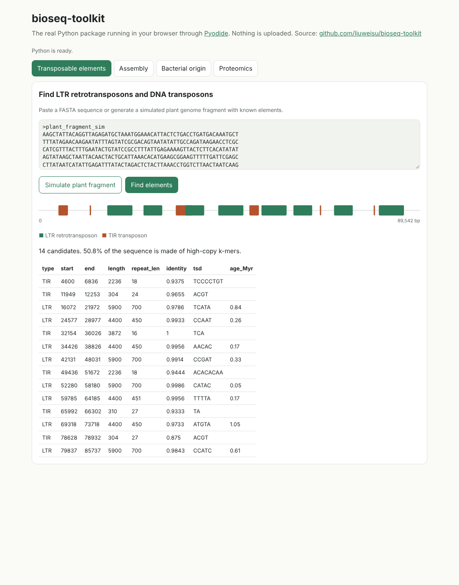

# bioseq-toolkit

[](https://github.com/liuweisu/bioseq-toolkit/actions/workflows/ci.yml)
**[Live demo in the browser](https://liuweisu.github.io/bioseq-toolkit/)**

Genome assembly, transposable element (TE) discovery, bacterial genomics and proteomics, written from scratch in plain Python with no dependencies.

Real work should use the established tools (SPAdes, EDTA, EarlGrey, Prodigal, MaxQuant, ...). I wrote this to show that I understand what those tools do inside, and to test each method against data where the right answer is known.

Because it uses only the standard library, the same package runs in the browser through Pyodide: the [demo page](https://liuweisu.github.io/bioseq-toolkit/) imports the real code, not a JavaScript copy.



## What is in it

| Module | Field | What it does |
| --- | --- | --- |
| `assembly` | Genomics | k-mer counting and spectrum, de Bruijn graph, unitig contigs (also closes circular chromosomes), N50 / L50 / NG50 |
| `te` | Plant & human TEs | LTR retrotransposon finder with LTR-based insertion dating, TIR (DNA transposon) finder, k-mer repeat masking, family classification against a RepeatMasker-style library |
| `variants` | Medical genomics | Finds large insertions in a patient sequence (e.g. a new Alu insertion in an exon), with TSD detection |
| `bacteria` | Bacterial DNA | oriC/terminus from cumulative GC skew, DnaA box enrichment, six-frame ORF finding, codon usage |
| `proteomics` | Proteomics | Monoisotopic/average masses, pI, GRAVY, enzyme digests, peptide mass fingerprinting |
| `align` | All | Needleman-Wunsch and Smith-Waterman |
| `simulate` | All | Synthetic datasets with a known truth for every method above |

## Quick start

```bash
git clone https://github.com/liuweisu/bioseq-toolkit
cd bioseq-toolkit
pip install -e ".[dev]"

bioseq simulate --outdir data                     # write the example datasets
bioseq assemble data/bacterium_reads.fq > contigs.fa
bioseq stats contigs.fa --genome-size 30000
bioseq te data/plant_fragment.fa --library data/te_library.fa
bioseq ori data/bacterium.fa
bioseq protein MKWVTFISLLFLFSSAYSRGVFRR

python examples/case_studies.py                   # the five case studies below
pytest
```

## Case studies

All five run in about two minutes; the full output is in [`examples/case_studies_output.md`](examples/case_studies_output.md).

**1. Assembling a bacterial chromosome.** 18,000 simulated 100 bp reads (30x, 0.5% errors) from a 60 kb circular chromosome. The k-mer spectrum separates error k-mers (seen once) from genomic ones (peak near 17x), which sets the `min_count` cut-off. With k = 31 the whole chromosome comes back as one contig. Smaller k (21: 4 contigs) makes the graph more tangled by short repeats; larger k (51: 8 contigs) leaves gaps because fewer reads contain an error-free 51-mer at each position.

**2. Transposable elements in a plant genome.** Ten simulated GC-poor genome fragments, each with 8 LTR retrotransposons (Copia and Gypsy) and 8 DNA transposons (Stowaway MITEs and hAT elements):

| Finder | Precision | Recall | Both ends exactly right |
| --- | --- | --- | --- |
| LTR retrotransposons | 1.00 | 0.93 | 73 / 80 |
| TIR transposons | 0.74 | 0.61 | 35 / 80 |

LTR elements are easy to find: two long, near-identical direct repeats a few kb apart, ending in TG...CA and flanked by a 5 bp target site duplication. TIR elements are much harder: their inverted repeats are only 18 to 30 bp long, so diverged copies lose the exact seeds and chance inverted repeats are common. That gap is the reason pipelines like EDTA combine several specialised finders and then filter their output. Each LTR element is also dated from the divergence between its two LTRs (T = K / 2r, r = 1.3e-8 per site per year).

**3. A new Alu-like insertion in a patient's gene.** New insertions of active human TEs cause disease, for example an Alu insertion in *NF1* in neurofibromatosis type 1 (Wallace et al. 1991) and L1 insertions in factor VIII in haemophilia A (Kazazian et al. 1988). Comparing a simulated patient allele with the reference finds a 318 bp insertion in exon 3, flanked by a target site duplication, with a poly(A) tail, best matching the SINE/Alu family in the library. The reported TSD is 14 bp instead of the true 12 bp because two extra flanking bases happen to match; the exact breakpoint is genuinely ambiguous in such cases.

**4. Origin of replication of a bacterial chromosome.** The minimum of the cumulative GC skew lands 4 bp from the true oriC, with DnaA boxes 17 times more frequent there than in the rest of the genome. The ORF finder recovers 59 of 60 planted genes, but half of its calls are random long ORFs, which shows why real gene finders such as Prodigal also model codon usage and ribosome binding sites.

**5. Peptide mass fingerprinting.** 24 noisy MALDI peaks (60% of the tryptic peptides plus 15 random peaks) searched against 200 proteins: the right protein wins with 9 matched peptides against 2 for the runner-up. The score subtracts the number of matches expected by chance, so long proteins with many peptides do not win by default.

## About the data

Everything in `bioseq.simulate` is random sequence with planted structure. Family names such as `AluLike` describe the structure being imitated, not real consensus sequences. To try real data:

- Plant TEs: a chromosome from [Phytozome](https://phytozome-next.jgi.doe.gov/) or NCBI with a TE library from [Dfam](https://www.dfam.org/) or the EDTA output for that genome.
- Bacteria: any complete genome from NCBI, e.g. *E. coli* K-12 MG1655 (NC_000913.3); its oriC is near position 3.92 Mb.
- Proteins: [UniProt](https://www.uniprot.org/) FASTA files work directly with `proteomics.digest`.

The pure-Python code handles a few Mb comfortably; whole genomes need the real tools.

## Project layout

```
src/bioseq/       the package (standard library only)
tests/            pytest suite, mostly checks against simulated truth
examples/         case studies and their output
docs/index.html   the Pyodide demo, deployed to GitHub Pages by .github/workflows/pages.yml
```

## License

MIT
